<p align="center">
  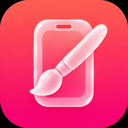
</p>

<h1 align="center">Store Art Studio</h1>

<p align="center">
  <b>Studio-grade App Store and Google Play screenshots, rendered from your app's real views, in every language you sell in.</b><br>
  A Claude Code skill. SwiftUI and Jetpack Compose proven. Higgsfield for the art, fastlane for delivery.
</p>

<p align="center">
  <a href="#install">Install</a> ·
  <a href="#quick-start">Quick start</a> ·
  <a href="#android">Android</a> ·
  <a href="#match-a-set-you-love">Match a set</a> ·
  <a href="#whats-inside">What's inside</a> ·
  <a href="https://store-art-studio.vercel.app">Web guide</a>
</p>

<p align="center">
  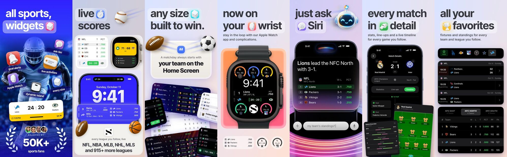
  <br><sub>A real set made with this method for <a href="https://apps.apple.com/app/id1533789849">Standings</a>: 7 slots in 22 languages, every screen the app's own view rendering real data.</sub>
</p>

---

## Why

Most store screenshots are mockups: a designer redraws the app, a model invents a UI, and the numbers on the phone stop matching the app the week after launch. Localizing them means 20 hand edits that drift.

Store Art Studio treats screenshots as code. Your real SwiftUI views render inside a test target that never launches the app, fed with sample data, on a page built in code. Changing a margin, a headline or a language is one edit and a rerender. The first app built this way shipped 154 screenshots and 22 product page headers from one codebase.

## How it works

| Layer | Made by | Rule |
|---|---|---|
| **Truth** | Your app's own views, rendered host-less from your data | Never redraw, generate or mock up app UI |
| **Atmosphere** | The Higgsfield MCP | Objects, stickers, hands, light, scenes. Never UI, never text |
| **Page** | SwiftUI (or Compose) in a render target | Headline, pill, background, layout, placed by baseline in pixels |
| **Delivery** | fastlane and the store APIs | Exact sizes, an approval list, never submits for review |

It works for any app, in seven phases, and stops for your approval after each:

1. **Discover**: it reads your project (screens, navigation, widgets, watch targets, notifications, locales, brand, your current listing) and tells you what it found.
2. **Ask**: structured questions for what the code cannot answer (features and order, design direction, first market, your copy rules, art budget, who uploads), recommended option first.
3. **Brief**: it writes `docs/screenshots/brief.md` from your answers; you edit and approve it.
4. **First draft**: a style tile, a calibration slot, then the full set in one language, real UI rendered host-less.
5. **Iterate**: rounds of renders and a thumbnail strip, your feedback, fixes, a decision log, until you approve.
6. **Localize**: per market, transcreated by its rules plus yours, width-tested, with a native-review list.
7. **Ship**: fastlane (`deliver` or `supply`), dry run first, then a pull-back comparison and the store checklist.

Before you see any render, it has opened it, looked at it small, compared it with your reference and fixed the differences.

## Install

You need [Claude Code](https://claude.com/claude-code). Clone the repo straight into your skills folder:

```bash
# For every project on this machine
git clone https://github.com/halilyuce/store-art-studio.git ~/.claude/skills/store-art-studio

# Or for one project only, from its root
git clone https://github.com/halilyuce/store-art-studio.git .claude/skills/store-art-studio

# Update later
git -C ~/.claude/skills/store-art-studio pull
```

Restart Claude Code and ask *"Is the store-art-studio skill available?"*.

Then connect the Higgsfield MCP and follow the setup for your platform. [INSTALL.md](INSTALL.md) is the connection checklist for both.

- **iOS:** add the `StoreArt` render target to your Xcode project. Step by step in the [web guide](https://store-art-studio.vercel.app) or [INSTALL.md](INSTALL.md).
- **Android:** copy the Paparazzi render module and HTML page kit from [templates/android/START-HERE.md](templates/android/START-HERE.md), render the sample once, then follow [docs/android-end-to-end.md](docs/android-end-to-end.md) phase by phase. See [Android](#android) below.

<details>
<summary><b>Requirements</b></summary>

| Need | Why |
|---|---|
| macOS with Xcode and an iOS simulator | The iOS renderer is an Xcode unit test bundle with no host app |
| Claude Code | The skill runs inside it |
| Higgsfield MCP with credits | Generates the 3D art. The skill asks before it spends |
| ImageMagick and `swift` | Keying and compositing art, the helper scripts |
| fastlane and an App Store Connect API key | Uploads and Product Page Optimization |
| Apple's product bezels | Download from Apple Design Resources. Their licence forbids redistribution, so they are not in this repo |
| Android: a JDK, Gradle, Paparazzi, Google Chrome | The Compose renderer is a JVM test; the HTML page kit renders with headless Chrome |

</details>

## Quick start

From your project's root, start a session:

```text
Use the store-art-studio skill. Discover this project, ask me what you cannot read
from it, and write the brief. Platform: iOS, iPhone 6.9".
```

It writes `docs/screenshots/brief.md` and stops for your approval. Prefer to write the brief yourself? Copy `templates/brief-template.md` there, fill in what you know, and say "Read docs/screenshots/brief.md and start at Gate 0".

The iOS template proves the pipeline before anything else:

```bash
scripts/screenshots/render.sh Sample
scripts/screenshots/tools/verify-export.sh StoreArt/Output 1320x2868
```

That renders a 1320 x 2868 opaque PNG from the sample slot. Swap the placeholder screen for one of your own views and you have your first real slot.

## Android

The same seven phases for Google Play. Paparazzi renders your real composables, Glance widgets, notification layouts and Wear OS UI on the JVM, with no emulator, device or account; an HTML page kit places them on the page; one `storeart.config.json` you own lists your markets and the surfaces your app has (phone screens always, everything else optional).

<p align="center">
  
  
  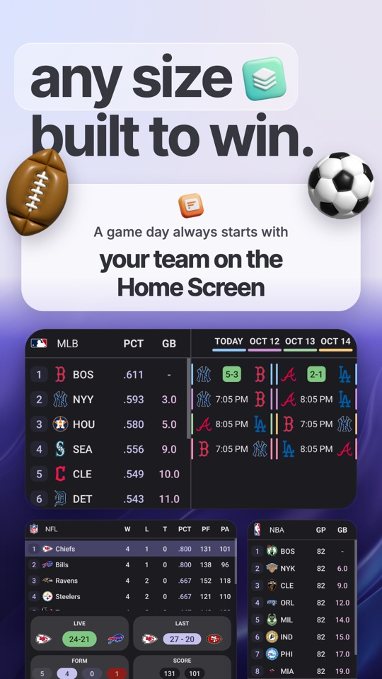
  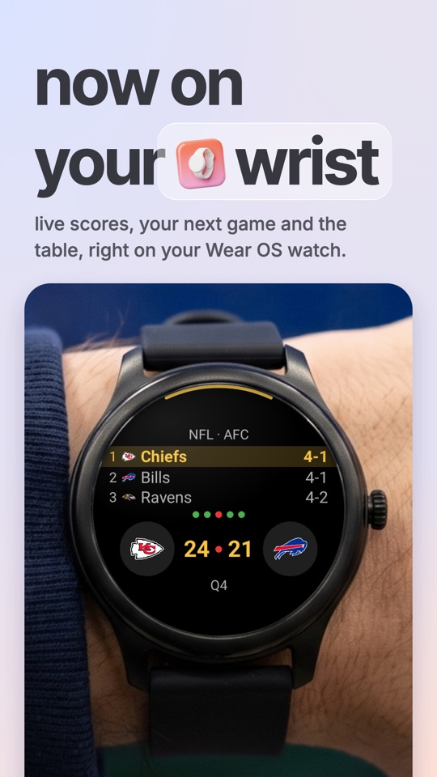
  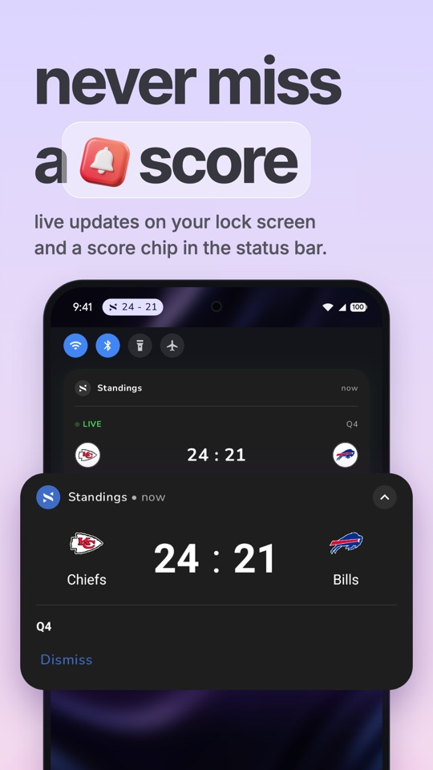
  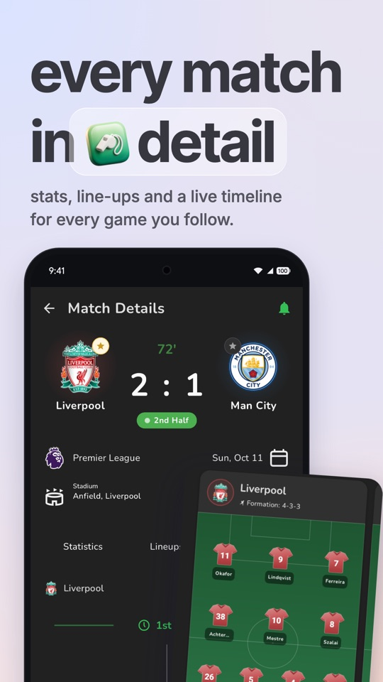
  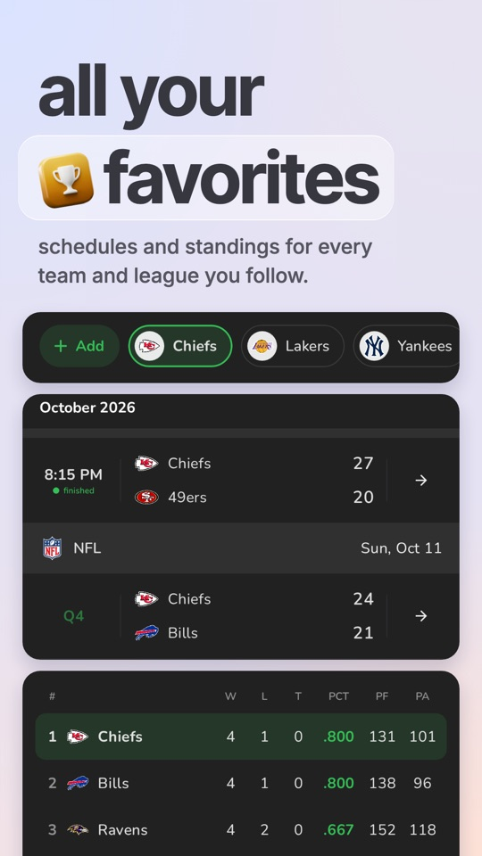
  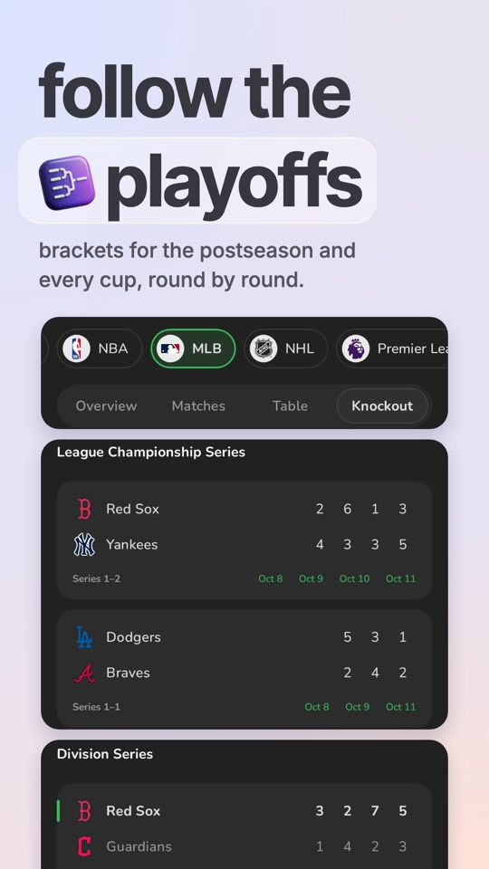
  <br>
  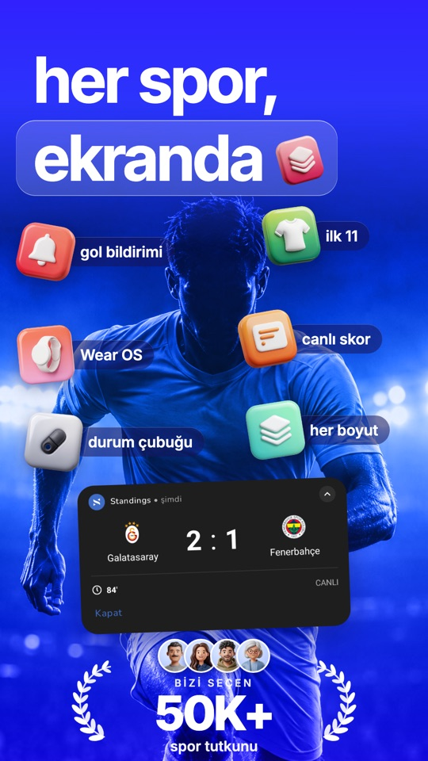
  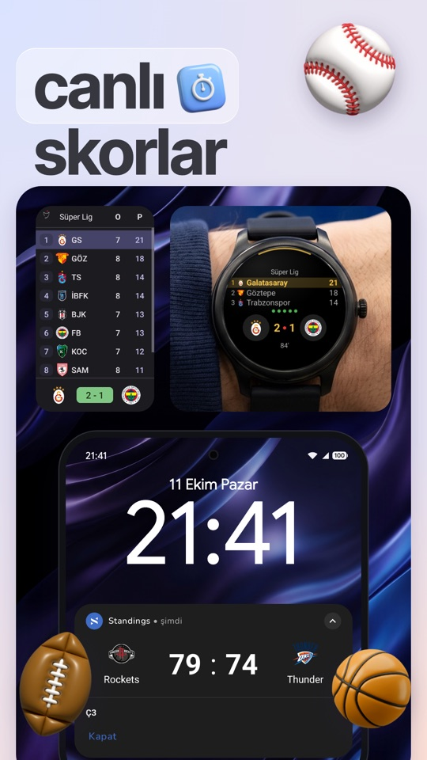
  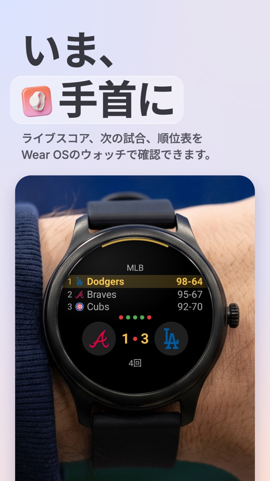
  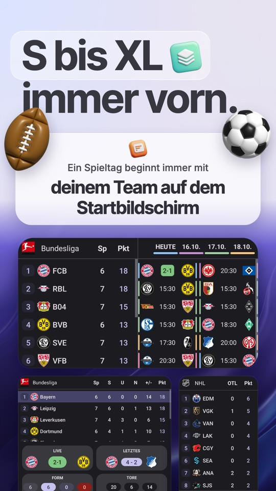
  
  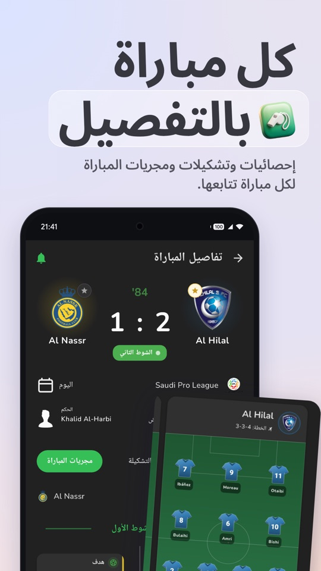
  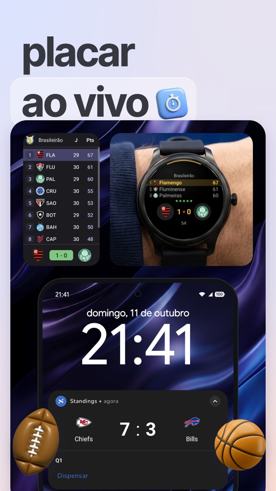
  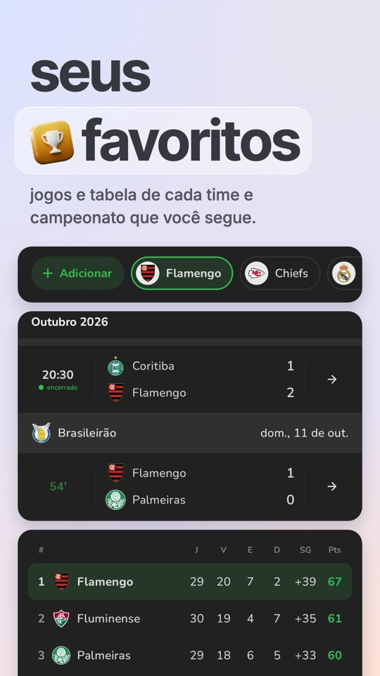
  <br>
  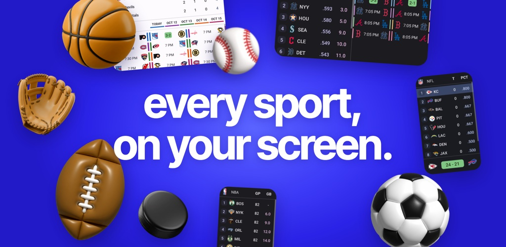
  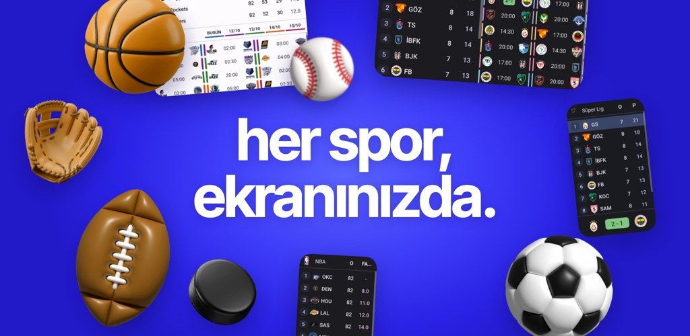
  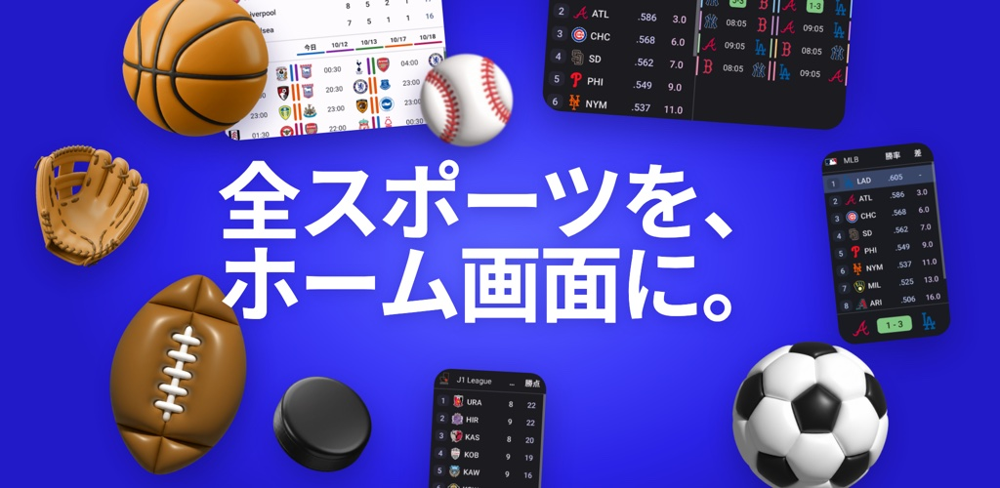
  <br><sub>Standings for Android, made with this skill: 8 Play slots and a feature graphic in 11 languages. Every widget, live notification, Wear OS tile and screen is the app's real UI rendered with Paparazzi; backgrounds, avatars and 3D objects are generated art with provenance.</sub>
</p>

What a run leaves in your repo:

```
docs/screenshots/brief.md          the brief: features, surfaces, design, your rules, decisions log
store/storeart.config.json         your markets, surfaces and the frozen moment (the only market list)
storeart/                          test-only Paparazzi module; renders to storeart/build/storeart/<code>/
store/page/                        slots.html, header.html, copy.js, COPY_NOTES.md, art/, tools/
store/page/out/<locale>/           01.png .. 08.png at 1080 x 1920, feature-graphic.png at 1024 x 500
store/page/out/play/<locale>/      the staged supply tree, verified, ready for the upload_art lane
```

Google Play has no draft for listing art, so the skill stages and runs a `validate_only` dry run, and you run the real upload. Start with [templates/android/START-HERE.md](templates/android/START-HERE.md); the walkthrough is [docs/android-end-to-end.md](docs/android-end-to-end.md).

## Match a set you love

Found screenshots you love? Put them in your repo and say what to take from them:

```text
Match this set: docs/screenshots/references/board.jpg.
Take its layout and type, keep our own colours and content.
Use the store-art-studio skill and start with the style tile.
```

The skill cuts the board into slots and measures margins, baselines, type size and palette with `probe.swift`. It builds a style tile for your approval, then loops: render, compare side by side with `compare.swift`, write down every difference, fix. It copies craft, never content: another brand's name, copy, icons and photography stay theirs.

## What's inside

```
SKILL.md                     the contract: layers, hard rules, the seven phases and their gates, review loop, slop checklist
INSTALL.md                   step-by-step setup and troubleshooting
docs/
  android-end-to-end.md      Android by phase, short prompts, the Play submission checklist
index.html                   the web guide (styled like App Store Connect)
references/
  discovery.md               reading a project on iOS and Android, the question bank, writing the brief
  iteration.md               feedback rounds, the decision log, when to stop
  architecture.md            layers, repo layout, the slot pattern, naming, "the world"
  ios-swiftui-renderer.md    building the host-less target, every trap with its fix
  android-compose.md         Compose, Glance widgets and Google Play, every trap with its fix
  higgsfield-art.md          what to generate, the MCP flow, keying and compositing recipes
  style-and-copy.md          palette, type, pill, layout archetypes, localization rules
  reference-matching.md      how a shared set is measured and matched
  fastlane-and-delivery.md   deliver, Product Page Optimization, headers, a safety checklist
templates/
  ios/                       StoreArt kit, sample slot and tests (compiles, renders 1320 x 2868)
  android/                   storeart Paparazzi module, HTML page kit, START-HERE.md
  fastlane/                  screenshots.yml manifest and the lanes
  brief-template.md          the brief the skill writes (or you fill by hand)
scripts/                     chromakey, edgekey, cutout, screenswap, greenbox, compare, probe, verify-export, ppo.rb
assets/                      the icon, example screenshots (iOS sets; Android: examples/android/standings), 3D art with provenance
site/                        source of index.html (template and build script)
```

## What's verified

- The iOS template and every Swift script compile. The template renders a 1320 x 2868 opaque PNG on an iOS 26 simulator.
- The method shipped a full 22-language set to App Store Connect, including a Product Page Optimization experiment and headers.
- The Android pipeline produced a full Play set for one production app: real composables, real Glance widgets and the real notification layout rendered by Paparazzi, an HTML page layer, 8 slots and a feature graphic per locale, left to right and right to left. `templates/android` is that pipeline made generic and domain-neutral: a sample app, two example markets, and one config you own for your markets. The template was built and run as it ships in a separate multi-module host app (Gradle 9.8, AGP 9.3.3, Kotlin 2.4.20, JDK 21, compileSdk 37, Paparazzi 2.0.0-alpha05): every sample surface in both example markets, the page kit, the width test and its negative test, `verify-export.sh` and Play staging. The examples above are that run. Not yet run from the template: an upload to a real Play listing. If something breaks, add it to "What broke" in `references/android-compose.md` and send it back.

## The web guide

**[store-art-studio.vercel.app](https://store-art-studio.vercel.app)** is an interactive version of the setup guide, styled like App Store Connect: iOS and Android tracks, copy buttons, progress you can tick off, and the example set in four languages.

It is built from `site/index.template.html`. After editing it, run `python3 site/build.py` and commit both the template and `index.html`.

## A note from me

I was planning to sell this skill. Then I decided to give it back to the community.

If it helps you ship better screenshots, the thank you I would love is simple: download my app **Standings** and, if you enjoy it, leave a rating. It means a lot to a small indie app. No strings attached.

<p>
  <a href="https://apps.apple.com/app/id1533789849">App Store</a> ·
  <a href="https://play.google.com/store/apps/details?id=com.labters.standings">Google Play</a>
</p>

Made by [Halil Yüce](https://github.com/halilyuce). The guide is styled after App Store Connect as a tribute and is not affiliated with Apple.

## Licences

Inter and Inter Tight are bundled under the SIL Open Font License (`templates/ios/Fonts`). Apple bezels and anything you generate under your own Higgsfield account are yours to license and are not included.
