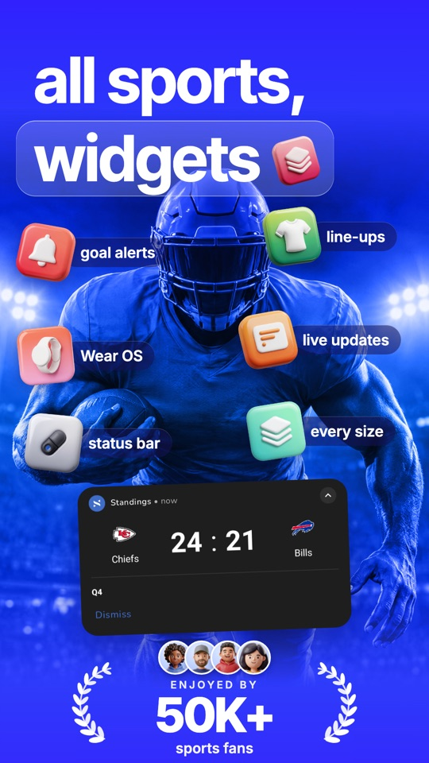
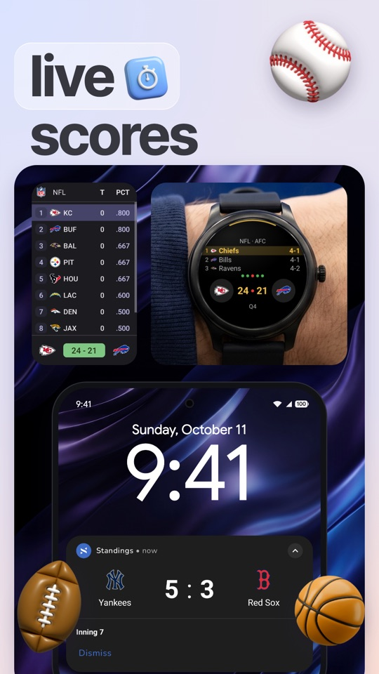
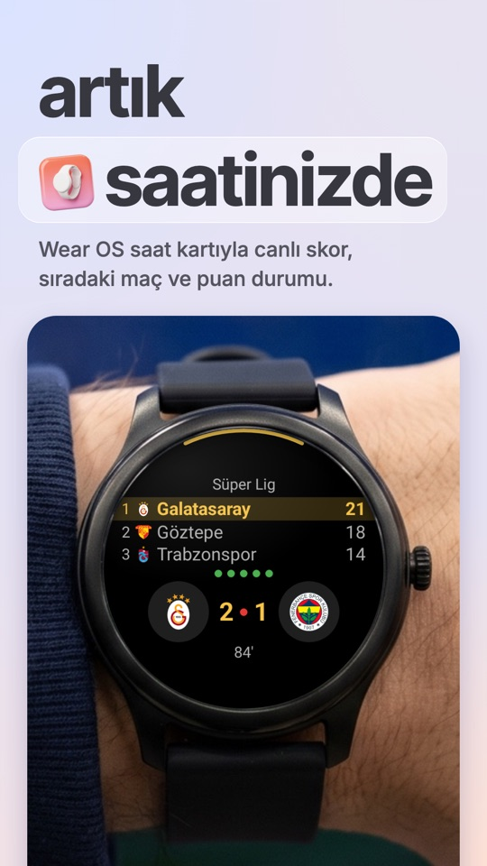
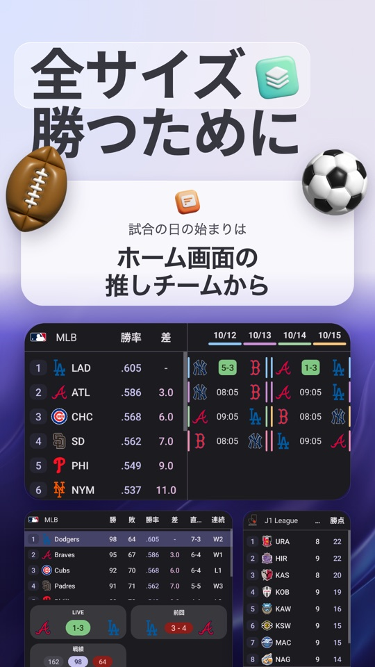
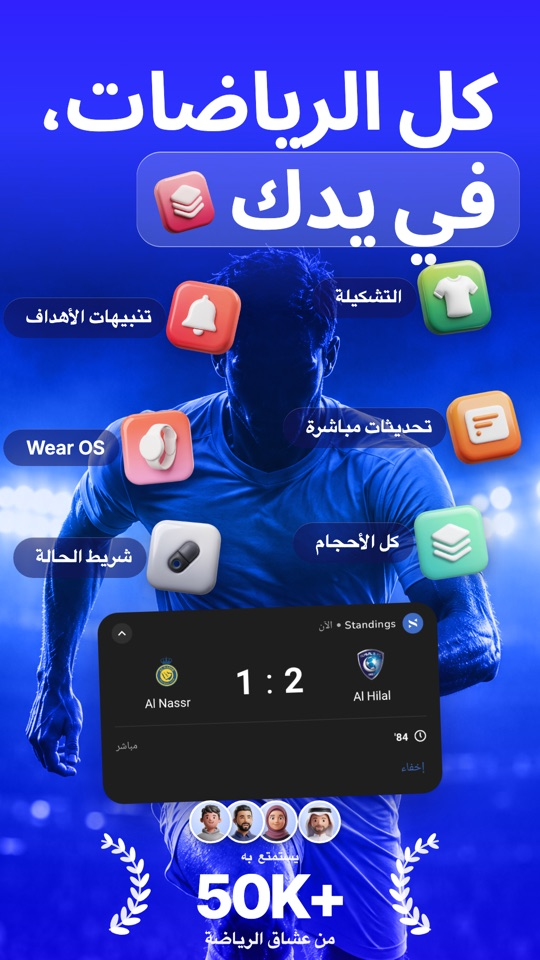

# Starting the Android side

<p>
  
  
  
  
  
</p>

<sub>Where this ends up: Standings for Android, made with this pipeline. The sample in this folder is deliberately plain; your app replaces it.</sub>

The Android pipeline is proven on one production app, and this folder is that pipeline with the app
taken out. It works the same for any kind of app: the sample is a neutral list-and-totals app, and
you replace its surfaces and data with your own.

New to the skill? `docs/android-end-to-end.md` in the skill folder walks the seven phases (discover,
ask, brief, first draft, iterate, localize, ship) with the Play checklist. This file is what to
copy, how to prove it renders, and the first prompt.

```
storeart.config.json            YOUR markets: store locale, app locale, time zone, clock, direction,
                                currency, digits, script font, upload approval. Copy to
                                <repo>/store/. Two example entries (one LTR, one RTL) to replace.
                                "surfaces": what your app has. Screens always; widgets,
                                notification, wear, tablet only if you ship them. The sample
                                lists all of them; trim it to yours.
storeart/                       a test-only Gradle module (Paparazzi), copy to <repo>/storeart/
  build.gradle.kts              plugins and dependencies through the version catalog; passes the
                                config path and the market selection to the tests
  libs.versions.snippet.toml    the catalog entries it needs, with the versions proven together
  logos.json                    logical id -> image URL (committed); placeholder images to start
  scripts/fetch_logos.py        downloads every URL once into src/test/resources/logos (gitignored)
  scripts/export.sh             fetch, render the selected markets, copy the PNGs to page/ui/<market>/
  src/main/.../StoreArtConfig.kt  reads storeart.config.json, selects markets (default market only)
  src/main/.../RecordEngine.kt  seeded records -> computed aggregates, seed picked to fit the story
  src/main/.../SampleWorld.kt   ShowcaseWorld: one world per market (the two examples)
  src/main/.../SampleUi.kt      PLACEHOLDER card, list screen and Glance widget; replace with your own
  src/test/.../StoreArtSupport.kt  Paparazzi setup, 412 x 915 dp at 3x, transparent theme, image
                                files with loud failure, 12/24 h, RTL, Glance via RemoteViews,
                                Material You wallpaper, PNG writer
  src/test/.../SampleSurfacesTest.kt  screen_list always; card_live and widget_list_big only when
                                surfaces lists notification and widgets; once per market
  src/main/.../SampleWear.kt    PLACEHOLDER watch tile and list; replace with your Wear UI
  src/test/.../WearSurfacesTest.kt  only with "wear" in surfaces: wear_01_tile, wear_02_list,
                                square, opaque Wear OS listing screenshots (raw watch UI, no
                                mask or frame), once per market
  src/test/.../WorldsTest.kt    every market's world holds together (plain JUnit, fast)
page/                           the HTML page layer, copy to <repo>/store/page/
  slots.html  kit.css  kit.js   two sample slots; kit.js reads the config (market, clock, date, font)
  copy.js  COPY_NOTES.md        copy per store locale, and its back-translations
  header.html                   the Play feature graphic
  tools/render.sh  render-header.sh  render-all.sh  widthtest.sh  stage-play.sh  markets.sh
```

Read `references/android-compose.md` first. Its "What broke" table is why each helper exists, and
"Adding a market" is the checklist for every market after the first.

## The first 30 minutes

From your Android project's root, with the skill installed at `~/.claude/skills/store-art-studio`
and the checklist in `INSTALL.md` ticked.

```bash
SKILL=~/.claude/skills/store-art-studio
mkdir -p store/tools
cp $SKILL/templates/android/storeart.config.json store/
cp -R $SKILL/templates/android/page store/page
cp -R $SKILL/templates/android/storeart storeart
cp $SKILL/scripts/* store/tools/
```

1. Add `include(":storeart")` to `settings.gradle(.kts)` and merge
   `storeart/libs.versions.snippet.toml` into `gradle/libs.versions.toml` (or let Claude do it in
   Gate 0, after it read your versions). No catalog yet: copy the snippet to
   `gradle/libs.versions.toml`. Two checks before the first build:
   - If the root build already declares AGP, Kotlin or Paparazzi (`apply false` or a buildscript
     classpath), set `agp`, `kotlin` and `paparazzi` in the catalog to exactly those versions.
   - If `gradle.properties` has `android.builtInKotlin=false`, uncomment
     `alias(libs.plugins.kotlin.android)` in `storeart/build.gradle.kts`. The build file tells you
     if you forget.
2. Leave the two example markets in `store/storeart.config.json` for now. The sample world is
   written for them. Gate 0 replaces them with your first market.
3. Render the sample surfaces and the page:

```bash
python3 storeart/scripts/fetch_logos.py
./gradlew :storeart:testDebugUnitTest --tests '*WorldsTest'
storeart/scripts/export.sh
store/page/tools/render-all.sh
store/page/tools/widthtest.sh
store/tools/verify-export.sh store/page/out 1080x1920 1024x500
```

4. Open `storeart/build/storeart/<code>/` (`card_live`, `widget_list_big` plain and `-dyn`,
   `screen_list`, `wear_*`, each light and `-dark`) and `store/page/out/<locale>/01.png`. Slots
   show your renders, or labelled boxes where a render or a piece of art is missing.
5. Add the module's and the page kit's `.gitignore` rules to your repo if your root `.gitignore`
   overrides them, and paste the prompt below. Claude takes it from there, one phase at a time.

If the build has convention plugins, use them in `storeart/build.gradle.kts` instead of the plain
plugins. For delivery, Gate 5 pastes `templates/fastlane/Fastfile.android.snippet.rb` into
`fastlane/Fastfile`.

If you already replaced the examples, the sample render fails with "no world for market". That
is expected: Gate 0 writes the world for your market.

## The prompt

Paste this into Claude Code from your Android project's root. It runs phases 1 to 3 and stops at
the brief; Gate 0 starts when you approve it.

```text
Use the store-art-studio skill for Google Play, following docs/android-end-to-end.md and
templates/android/START-HERE.md in the skill folder.

1. Discover: read this project (modules, navigation and screens, view models, the manifest,
   widgets, notifications, Wear OS, string files per locale, brand, any fastlane metadata) and
   summarise what you found. Do not build or run anything.
2. Ask me only what the project cannot answer, in batches with your recommended option first:
   features and their order, surfaces to show, design direction, first market, my copy rules,
   the art budget and kind, who uploads.
3. Write docs/screenshots/brief.md and store/storeart.config.json (my first market only,
   "upload": false, "surfaces" as I chose), then stop for my approval.

Before you edit any Gradle file in Gate 0, tell me what this project uses (AGP, Kotlin, compileSdk,
Compose BOM, Glance, Coil, JDK, any screenshot library) and the exact changes, and wait. Never run
my real app, an emulator signed in to a real account, or anything that syncs.
```

What Gate 0 then does: adds the module, the page kit and the config; renders the sample and opens
every PNG; replaces the placeholders in `SampleUi.kt` (and `SampleWear.kt`) with your real
composables (widgets through `GlanceRemoteViews` and an `AppWidgetHostView`), adding a seam where
one needs a ViewModel, a repository or the clock; replaces the sample world with a frozen world for
your first market (one moment, full lists with computed totals, no real people, no
`System.currentTimeMillis()` in a rendered path, role ids); checks Higgsfield and writes a plan
with a credit estimate. It stops with the renders, `verify-export.sh` passing, the plan, which
screens are redraws, and what broke (added to "What broke" in `references/android-compose.md`).

## After Gate 0

Continue phase by phase with `docs/android-end-to-end.md` or the workflow in `SKILL.md`. Have a
reference set? Say so in the first message: `references/reference-matching.md` is for that.

## What to send back

Anything that broke in the generic template and not in the reference doc is worth a pull request:
the fix in `templates/android` and a row in "What broke".
